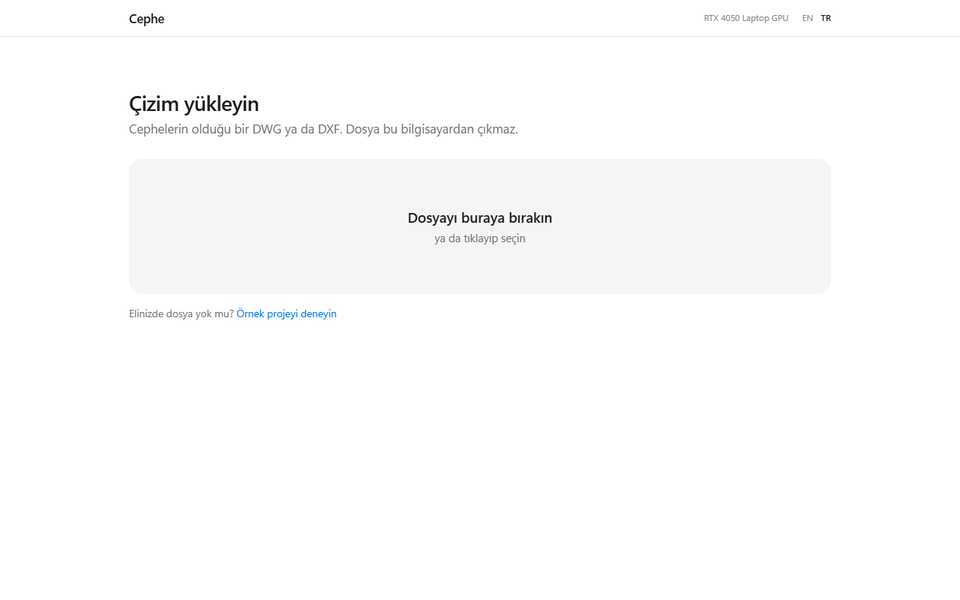
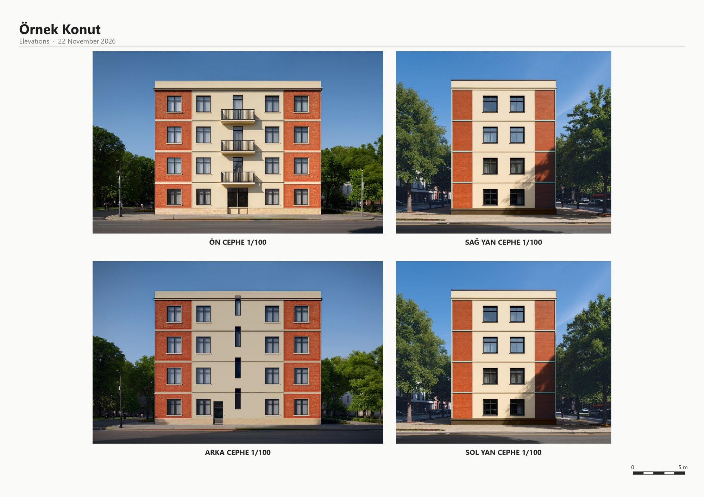
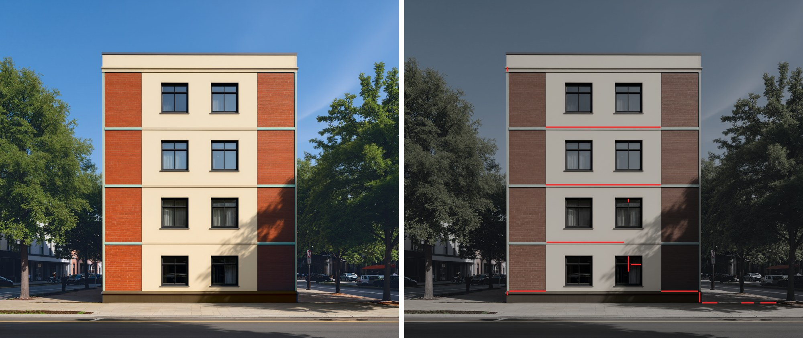

# Cephe

**Mühendisin cephe çiziminden, birbiriyle tutarlı sunum render'ları ve hazır bir sunum paftası.**

DWG dosyanızı bırakın. Cephe bütün görünüşleri bulur ve hepsini aynı malzeme, aynı gökyüzü, aynı ölçek ve tek
bir güneş altında render eder. Sonuç, aynı binanın fotoğrafları gibi duran bir A3 paftadır. Prompt yazmak, ayar
bilmek gerekmez. Her şey kendi bilgisayarınızda çalışır; çizimleriniz dışarı çıkmaz.



[English below](#english)

## Örnek sonuç

Aşağıdaki pafta, depodaki örnek çizimden ([examples/ornek_proje.dwg](examples/ornek_proje.dwg)) tek tıkla
üretildi: dört cephe, aynı malzemeler, tek güneş, tek ölçek.



## Ne yapar

1. **Görünüşleri bulur.** Adlarını paftadaki yazılardan okur ("ÖN CEPHE", "KUZEY CEPHESİ", "NORTH ELEVATION").
   Cepheyi kesitten ve plandan ayırır.
2. **Çizimi temizler.** Ölçüler, yazılar, akslar, kot işaretleri, taramalar ve antet render'a girmez.
3. **Malzemeyi taramadan okur.** Tuğla taranan yer tuğla, taş taranan yer taş olur. İstediğinizi
   değiştirebilirsiniz ("tuğla: sarı").
4. **Bütün cepheleri tutarlı render eder.**
   - Aynı malzeme, aynı gökyüzü, aynı renkler.
   - **Tek güneş:** seçtiğiniz saate göre her cephenin güneşte mi, yandan ışıkta mı, gölgede mi olduğunu
     hesaplar.
   - **Tek ölçek:** bir pencere her cephede aynı boyuttadır.
5. **Çizime uyumu ölçer.** Her render'ın çizimin çizgilerine ne kadar uyduğunu yüzde olarak gösterir. Çizimden
   sapan cepheyi kendiliğinden bir kez daha çizer.
6. **Paftayı hazırlar.** Başlıklı, ölçek çubuklu bir A3 pafta, PDF ve PNG olarak.

## Görüntü tabanlı araçlardan farkı

Bir render aracına cephenin ekran görüntüsünü verdiğinizde araç sadece bir resim görür. Cephe ise DWG'nin
kendisini okur:

- **Hangi görünüş hangisi**, hangi yöne bakıyor: başlıklardan.
- **Nerede hangi malzeme var:** taramalardan.
- **Gerçek ölçek:** çizim biriminden. Bütün cepheler aynı piksel/metre oranıyla çizilir.
- **Çizime sadakat:** render, çizimin kendi çizgileriyle kontrol edilir.

Bu yüzden dört cephe ayrı ayrı üretilmiş dört resim gibi değil, tek bir binanın fotoğrafları gibi durur.

## Çizime uyum

Yapay zekâ render'ı bazen bir kaydı atlar, korkuluk sayısını değiştirir ya da bir çizgiyi kaydırır. Cephe bunu
gözle aramanızı beklemez. Çizimdeki her çizgi boyunca render'a bakar: çizginin tam üstünde, yanındaki dokudan
belirgin biçimde güçlü bir kenar var mı? Sonuç her cephenin altında **"Çizime uyum %…"** olarak yazar.
**"Farkları göster"** dediğinizde render'ın kaybettiği ya da kaydırdığı çizgiler kırmızıyla işaretlenir.



Puan %80'in altına düşerse o cephe başka bir varyasyonla bir kez daha çizilir ve çizime daha iyi uyan sürüm
tutulur. Bu kontrol 2K detaydan önce, hızlı ilk geçişte yapılır; böylece zaman kaybı az olur.

## Kurulum

**Gerekenler:** Windows 10/11, en az 6 GB belleği olan bir NVIDIA ekran kartı, ~40 GB boş disk ve kurulum için
internet bağlantısı.

1. Bu sayfada **Code → Download ZIP** ile indirip bir klasöre açın.
2. **`Install.bat`** dosyasına çift tıklayın ve soruları yanıtlayın. Kurulum şunları yapar:
   - ekran kartını kontrol eder;
   - render motorunu (ComfyUI) bulur, yoksa resmî taşınabilir sürümünü indirir (~2 GB);
   - DWG okumak için ücretsiz **ODA File Converter**'ı kurar. Lisansını onaylamanız istenir; reddederseniz DXF
     dosyaları yine çalışır;
   - yapay zekâ modellerini indirir (~24 GB). İndirme yarıda kalırsa kurulumu tekrar çalıştırın, kaldığı
     yerden devam eder;
   - masaüstüne **Cephe** kısayolunu koyar.

Kurulumu tekrar çalıştırmak güvenlidir: hazır olan her şey atlanır.

## Kullanım

1. Masaüstündeki **Cephe** kısayoluna tıklayın. Uygulama tarayıcınızda açılır ve render motorunu arka planda
   başlatır. İlk açılış 1-2 dakika sürebilir.
2. DWG/DXF dosyanızı bırakın ya da **Örnek projeyi deneyin**'e tıklayın.
3. Render edilecek cepheleri seçin. Adında yön olmayan cephelerde ("YAN CEPHE") yönü siz seçin.
4. Yapı türünü, çevreyi, mevsimi, saati ve ön cephenin baktığı yönü seçin. Bulunan malzemeleri kontrol edin.
5. İsterseniz önce **Hızlı önizleme** alın (cephe başına yaklaşık 1 dk). Beğendiğinizde **Sunum render'ı**
   alın (cephe başına yaklaşık 3,5 dk; 2K ve pafta). "Başka bir varyasyon" aynı ayarlarla farklı bir sonuç
   verir.
6. Her cephenin altındaki **çizime uyum** puanına bakın.
7. Paftayı PDF olarak ya da her şeyi tek dosyada indirin.

Süreler RTX 4050 Laptop (6 GB) içindir. Arayüz varsayılan olarak İngilizce açılır; sağ üstteki **TR** ile
Türkçeye geçer. Türkçe ve İngilizce başlıklı çizimler iki dilde de tanınır.

## Çizimlerden en iyi sonucu almak

- **Her görünüşün altına başlık yazın:** "ÖN CEPHE", "KUZEY CEPHESİ", "A-A KESİTİ", "ZEMİN KAT PLANI" (ya da
  İngilizcesi). Uygulama hem adı hem yönü buradan okur.
- **Malzemeyi tarama olarak verin.** Katman adı ya da tarama deseni malzemeyi söylesin: `TUGLA`, `TAS`,
  `BETON`, `AHSAP`, `METAL`, `CAM`, `SIVA` (İngilizceleri de olur: `BRICK`, `STONE`…); `BRICK`, `AR-B816`,
  `AR-CONC` gibi desenler. Tanınmayan taramalar listede çıkar, malzemesini siz seçersiniz.
- **Çizimleri model alanında birbirinden ayrı tutun.** Aralarında boşluk olsun; zemin çizgileri birbirine
  değmesin.
- Kapalı ya da dondurulmuş katmanlar render'a girmez: AutoCAD'de görmediğiniz şey render'da da olmaz.

## Sınırlar

- **Sunum içindir, uygulama projesi için değil.** Ölçüsel doğruluk garanti edilmez.
- **Çizime uyum kontrolü çizgilere bakar, anlama değil.** Kaybolan ya da kayan çizgiyi bulur (eksik bir kayıt,
  yanlış sayıda korkuluk). Render'ın çizimde olmayan bir şey eklemesini henüz yakalamaz. Birbirine çok yakın
  çift çizgiler (bant, çerçeve) render'da tek çizgi olunca kısmen fark sayılır.
- **Işık ve gölge yönlendirilir, fiziksel olarak hesaplanmaz.** Balkon gölgesinin boyu gibi ayrıntılar
  yaklaşıktır.
- **Şimdilik yalnızca cepheler.** Kesit ve plan render'ı, PDF ve görsel girdi sonraki sürümlerde.

## Nasıl çalışır

```
core/inputs/dwg.py   DWG/DXF -> Sheet (çizgiler, taramalar, yazılar), birim algılama
core/classify.py     başlık -> görünüş türü ve yönü (Türkçe + İngilizce)
core/geometry.py     çizimleri ayırma, ortak ölçek, rasterleştirme, malzeme bölgeleri
core/materials.py    tarama -> malzeme, malzeme kataloğu
core/scene.py        arayüz seçimleri -> prompt'lar, tek güneş hesabı
core/workflow.py     ComfyUI grafikleri (Z-Image-Turbo + Fun Union ControlNet, bölgesel prompt'lar)
core/tiles.py        2K detay geçişi, üst üste binen ~1 MP parçalarla
core/fidelity.py     çizime uyum puanı ve fark haritası
core/harmonize.py    cepheler arası renk eşitleme, gölge tonu
core/presentation.py sunum paftası
core/project.py      bunları birleştiren proje / render işi
core/i18n.py         kullanıcıya görünen metinler (en, tr)
app/server.py        yerel web sunucusu (Flask), iş kuyruğu, ComfyUI'ı arka planda başlatır
installer/           Install.bat'in yaptığı her şey
```

Render iki geçişlidir. İlk geçiş ~1 MP'de çizimin çizgilerini ControlNet ile izler; her malzemenin kendi
prompt'u yalnızca kendi bölgesine uygulanır. Sunum render'ında görüntü 2 katına büyütülür ve üst üste binen
~1 MP parçalar halinde, çizimin 2 kat çözünürlüklü çizgilerini izleyerek yeniden detaylandırılır. Böylece
görüntü kenardan kenara keskin kalır.

**Geliştirme:**

- Testler: `.venv\Scripts\python -m pytest tests`
- Örnek projeyi yeniden üretmek: `python tools/make_sample.py examples/ornek_proje.dwg`
- README demosunu yeniden kaydetmek (uygulama açıkken): `python tools/record_demo.py projects\<id>\<render>\result.json`
- Yeni bir arayüz dili eklemek: `core/i18n.py`, `core/scene.py` ve `core/materials.py` içindeki etiketler,
  `app/static/index.html` içindeki `I18N` tablosu.

## Lisanslar

Bu depo için henüz bir açık kaynak lisansı seçilmedi; kod herkese açık olarak görülebilir ama tüm hakları
saklıdır. Kullanılan modellerin kendi lisansları vardır: Z-Image-Turbo ve Fun Union ControlNet (Alibaba),
RealESRGAN. Ticari kullanımdan önce her birinin lisansını kontrol edin. ODA File Converter, Open Design
Alliance'ın kendi lisansıyla dağıttığı ücretsiz bir araçtır ve bu depoya dahil değildir.

---

## English

**Consistent presentation renders and a ready-made presentation sheet, straight from an engineer's elevation
drawings.**

Drop in a DWG file. Cephe ("facade" in Turkish) finds every elevation and renders them all with the same
materials, the same sky, one scale and one sun, so they read as photos of one building, laid out on an A3
sheet. No prompts to write, no settings to learn. Everything runs on your own computer; your drawings never
leave it. The demo and sample sheet at the top of this page were made from
[examples/ornek_proje.dwg](examples/ornek_proje.dwg) in this repository.

**What it does**

1. **Finds every view** and reads its name and direction from the titles on the sheet ("FRONT ELEVATION",
   "NORTH ELEVATION", "ÖN CEPHE"). Tells elevations apart from sections and plans.
2. **Cleans the drawing:** dimensions, text, grid axes, level marks, hatching and the title block stay out of
   the render.
3. **Reads materials from the hatches:** where brick is hatched you get brick. You can change any of them.
4. **Renders all facades consistently:** same materials and sky; **one sun** (from the time of day, it works out
   whether each facade is in sun, side-lit or in shade); **one scale** (a window is the same size on every
   facade).
5. **Measures how closely each render follows the drawing.** Every facade gets a "Drawing match %" score;
   "Show differences" marks in red the lines the render lost or moved. A facade that drifts too far is redrawn
   once automatically, and the closer version is kept.
6. **Builds the presentation sheet:** A3, with titles and a scale bar, as PDF and PNG.

**Why it's different.** Image-based tools only see a picture. Cephe reads the DWG itself: which view is which
and which way it faces, where each material is, the real scale, and the drawing's own lines to check the
render against.

**Setup.** Windows 10/11, an NVIDIA GPU with at least 6 GB, ~40 GB of free disk, internet for setup.
Download this repository (**Code → Download ZIP**), unzip it and double-click **`Install.bat`**. It checks the
GPU, finds ComfyUI or downloads its portable build (~2 GB), installs the free ODA File Converter with your
consent (DXF works without it), downloads the models (~24 GB, resumable) and puts a **Cephe** shortcut on the
desktop. Running it again is safe.

**Use.** Click the **Cephe** shortcut, drop your DWG/DXF or try the sample project, pick facades and scene,
make a quick preview (~1 min per facade) and then the presentation render (~3.5 min per facade, 2K + sheet) on
an RTX 4050 Laptop GPU. The interface is in English by default; switch to Turkish with **TR**.

**Getting good results.** Title each view under the drawing; give materials as hatches whose layer name or
pattern names the material (`BRICK`, `STONE`, `CONCRETE`, `WOOD`, `METAL`, `GLASS`, `PLASTER`, or Turkish
`TUGLA`, `TAS`, `BETON`…); keep drawings apart in model space. Layers that are off or frozen are left out.

**Limits.** For presentation, not construction documents. The drawing-match check finds lost or moved lines but
not things the render adds; close double lines drawn as one count partly as misses. Light and shadow are
steered, not physically simulated. Elevations only for now; sections, plans, PDF and image inputs come later.

**License.** No open-source license has been chosen yet: the code is public to read, all rights reserved. The
models have their own licenses (Z-Image-Turbo and Fun Union ControlNet by Alibaba, RealESRGAN); check them before
commercial use. ODA File Converter is a free tool from the Open Design Alliance under its own license and is not
bundled.
